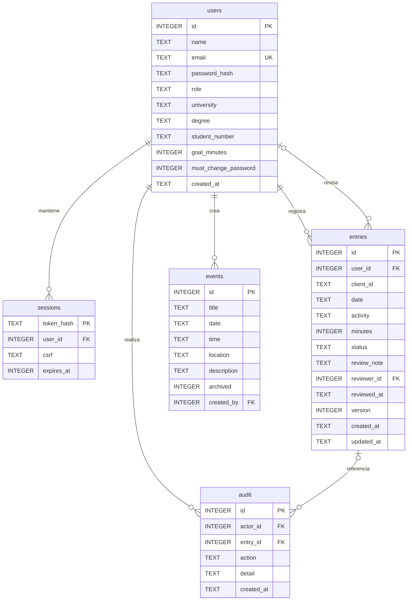

# Patoli: proceso lógico, modelo físico y diagrama entidad–relación

## 1. Alcance y fuente

Documento elaborado a partir de `database.mjs`, proporcionado por el usuario. El archivo importa `DatabaseSync` desde `node:sqlite`: **la implementación recibida usa SQLite, no MySQL**. Se documenta el esquema declarado por este archivo; no se inspeccionó una base de datos en ejecución. `CREATE TABLE IF NOT EXISTS` no comprueba ni actualiza la estructura de tablas preexistentes.

El esquema contiene cinco tablas: `users`, `sessions`, `entries`, `audit` y `events`. La sección final indica aspectos por revisar para una migración a MySQL; no representa una migración realizada.

## 2. Proceso y modelo lógico

### 2.1 Entidades

| Entidad | Responsabilidad | Identificador lógico |
| --- | --- | --- |
| Usuario | Identidad, acceso, rol y meta de horas | id |
| Sesión | Mantener una sesión asociada a un usuario | token_hash |
| Jornada | Registrar actividad y minutos de servicio de un usuario | id |
| Auditoría | Registrar acciones de un usuario | id |
| Evento | Mantener la agenda de actividades | id |

### 2.2 Flujo funcional representado por los datos

1. **Usuario:** se almacena su nombre, correo único, hash de contraseña, rol y datos académicos. La meta inicial es de 28 800 minutos, equivalentes a 480 horas.
2. **Sesión:** cada sesión referencia a un usuario y conserva un hash de token, un dato CSRF y un vencimiento. El archivo no especifica la unidad de `expires_at` ni el algoritmo de generación de tokens.
3. **Registro de jornada:** cada jornada pertenece a un usuario e incluye fecha, actividad y minutos. Se crea con estado `pending` por defecto. La combinación `(user_id, client_id)` debe ser única y permite identificar envíos repetidos del mismo usuario.
4. **Revisión:** la jornada permite almacenar un revisor, una nota y una fecha de revisión. Los estados admitidos son `pending`, `approved`, `rejected` y `cancelled`. El esquema no define las transiciones permitidas ni exige que el revisor sea administrador.
5. **Avance:** los datos permiten sumar minutos por usuario y estado, y compararlos con `goal_minutes`. No existe una tabla ni una columna de porcentaje de avance. El cálculo y la selección de estados que cuentan para el avance corresponden a la aplicación, no a este archivo.
6. **Auditoría:** cada registro identifica un actor y puede vincularse a una jornada. No hay disparadores que creen estos registros automáticamente: la aplicación debe insertarlos.
7. **Agenda:** cada evento referencia a un usuario creador. No se define una relación directa entre eventos y jornadas ni una tabla de asistencia.

### 2.3 Relaciones y cardinalidades

| Tabla padre | Tabla hija y clave foránea | Cardinalidad | Obligatoriedad en la hija |
| --- | --- | --- | --- |
| users | sessions.user_id | 1 a 0..N | Cada sesión tiene un usuario |
| users | entries.user_id | 1 a 0..N | Cada jornada tiene un propietario |
| users | entries.reviewer_id | 0..1 a 0..N | Cada jornada puede tener un revisor |
| users | audit.actor_id | 1 a 0..N | Cada registro tiene un actor |
| entries | audit.entry_id | 0..1 a 0..N | Cada registro puede referirse a una jornada |
| users | events.created_by | 1 a 0..N | Cada evento tiene un creador |

Los roles no crean entidades separadas: estudiantes y administradores comparten `users`. Las restricciones de rol para registrar, revisar o crear eventos deben verificarse en la aplicación. No hay relaciones muchos a muchos explícitas.

## 3. Diagrama entidad–relación

El diagrama muestra todos los atributos y las relaciones declaradas. `PK` indica clave primaria; `FK`, clave foránea; `UK`, unicidad individual. La unicidad compuesta de `entries` se describe debajo.



`entries` tiene además una restricción `UNIQUE(user_id, client_id)`: ninguno de esos campos es único por separado. Las relaciones son no identificadoras en el sentido de que las claves foráneas no forman parte de las claves primarias de las tablas hijas; las líneas del diagrama priorizan la cardinalidad.

## 4. Modelo físico implementado en SQLite

### 4.1 Inicialización y almacenamiento

- `openDatabase(filename)` recibe la ubicación de la base de datos. Este archivo no fija una ruta ni un nombre concreto.
- Si `filename` no es `:memory:`, crea recursivamente el directorio contenedor.
- Activa claves foráneas mediante `PRAGMA foreign_keys = ON`.
- Solicita modo de diario `WAL`; una base en memoria no utiliza un archivo WAL persistente.
- Configura `busy_timeout = 5000` milisegundos.
- Crea tablas e índices si no existen y establece `user_version = 1`. No incluye un sistema de migraciones de versiones anteriores.
- `transaction(db, fn)` ejecuta `BEGIN IMMEDIATE`, confirma con `COMMIT` si la función termina correctamente y ejecuta `ROLLBACK` si lanza una excepción.

### 4.2 Diccionario de datos

Los tipos siguientes son los declarados en SQLite. No hay tablas `STRICT`. Las columnas `INTEGER PRIMARY KEY` son identificadores asociados a `rowid`; pueden recibir un valor generado al insertar. No se declara `AUTOINCREMENT`.

#### users

Usuarios: identidad, credenciales, rol y meta de servicio social.

| Columna | Tipo | Nulabilidad | Predeterminado | Clave o referencia |
| --- | --- | --- | --- | --- |
| id | INTEGER | NOT NULL | Sin DEFAULT | PK |
| name | TEXT | NOT NULL | Sin DEFAULT | — |
| email | TEXT | NOT NULL | Sin DEFAULT | UNIQUE, COLLATE NOCASE |
| password_hash | TEXT | NOT NULL | Sin DEFAULT | — |
| role | TEXT | NOT NULL | Sin DEFAULT | — |
| university | TEXT | NOT NULL | `''` | — |
| degree | TEXT | NOT NULL | `''` | — |
| student_number | TEXT | NOT NULL | `''` | — |
| goal_minutes | INTEGER | NOT NULL | `28800` | — |
| must_change_password | INTEGER | NOT NULL | `0` | — |
| created_at | TEXT | NOT NULL | `strftime('%Y-%m-%dT%H:%M:%fZ','now')` | — |

#### sessions

Sesiones: token almacenado como hash, usuario, dato CSRF y vencimiento.

| Columna | Tipo | Nulabilidad | Predeterminado | Clave o referencia |
| --- | --- | --- | --- | --- |
| token_hash | TEXT | Sin NOT NULL explícito; véase nota | Sin DEFAULT | PK |
| user_id | INTEGER | NOT NULL | Sin DEFAULT | FK → users.id |
| csrf | TEXT | NOT NULL | Sin DEFAULT | — |
| expires_at | INTEGER | NOT NULL | Sin DEFAULT | — |

#### entries

Jornadas: actividad, duración, estado y revisión de horas.

| Columna | Tipo | Nulabilidad | Predeterminado | Clave o referencia |
| --- | --- | --- | --- | --- |
| id | INTEGER | NOT NULL | Sin DEFAULT | PK |
| user_id | INTEGER | NOT NULL | Sin DEFAULT | FK → users.id |
| client_id | TEXT | NOT NULL | Sin DEFAULT | — |
| date | TEXT | NOT NULL | Sin DEFAULT | — |
| activity | TEXT | NOT NULL | Sin DEFAULT | — |
| minutes | INTEGER | NOT NULL | Sin DEFAULT | — |
| status | TEXT | NOT NULL | `'pending'` | — |
| review_note | TEXT | NOT NULL | `''` | — |
| reviewer_id | INTEGER | Admite NULL | Sin DEFAULT | FK → users.id |
| reviewed_at | TEXT | Admite NULL | Sin DEFAULT | — |
| version | INTEGER | NOT NULL | `1` | — |
| created_at | TEXT | NOT NULL | `strftime('%Y-%m-%dT%H:%M:%fZ','now')` | — |
| updated_at | TEXT | NOT NULL | `strftime('%Y-%m-%dT%H:%M:%fZ','now')` | — |

#### audit

Auditoría: actor, acción, detalle y jornada asociada cuando corresponde.

| Columna | Tipo | Nulabilidad | Predeterminado | Clave o referencia |
| --- | --- | --- | --- | --- |
| id | INTEGER | NOT NULL | Sin DEFAULT | PK |
| actor_id | INTEGER | NOT NULL | Sin DEFAULT | FK → users.id |
| entry_id | INTEGER | Admite NULL | Sin DEFAULT | FK → entries.id |
| action | TEXT | NOT NULL | Sin DEFAULT | — |
| detail | TEXT | NOT NULL | Sin DEFAULT | — |
| created_at | TEXT | NOT NULL | `strftime('%Y-%m-%dT%H:%M:%fZ','now')` | — |

#### events

Eventos: información de agenda, archivo y usuario creador.

| Columna | Tipo | Nulabilidad | Predeterminado | Clave o referencia |
| --- | --- | --- | --- | --- |
| id | INTEGER | NOT NULL | Sin DEFAULT | PK |
| title | TEXT | NOT NULL | Sin DEFAULT | — |
| date | TEXT | NOT NULL | Sin DEFAULT | — |
| time | TEXT | NOT NULL | Sin DEFAULT | — |
| location | TEXT | NOT NULL | Sin DEFAULT | — |
| description | TEXT | NOT NULL | Sin DEFAULT | — |
| archived | INTEGER | NOT NULL | `0` | — |
| created_by | INTEGER | NOT NULL | Sin DEFAULT | FK → users.id |

**Nota sobre `sessions.token_hash`:** en una tabla SQLite ordinaria, `TEXT PRIMARY KEY` sin `NOT NULL` explícito tiene la particularidad de poder aceptar `NULL`. No debe documentarse como una garantía de no nulabilidad. Si se requiere esa garantía, deberá reforzarse en una migración o en la aplicación.

### 4.3 Restricciones y valores

| Elemento | Regla declarada |
| --- | --- |
| users.email | Obligatorio, único y comparado con `NOCASE`; no implica validación del formato de correo |
| users.role | Solo `student` o `admin` |
| users.goal_minutes | Mayor que cero; valor inicial 28800 |
| entries.minutes | Mayor que cero, máximo 1440, múltiplo de 15 |
| entries.status | `pending`, `approved`, `rejected` o `cancelled`; inicial `pending` |
| entries(user_id, client_id) | Combinación única |
| reviewer_id, reviewed_at | Admiten NULL; no hay una regla que obligue a asignarlos conjuntamente |
| must_change_password, archived | Enteros con valor inicial 0; no existe CHECK que limite a 0 y 1 |
| entries.version | Entero con valor inicial 1; no hay incremento automático ni CHECK positivo |
| created_at, updated_at | Texto con valor inicial UTC generado por `strftime`; `updated_at` no se actualiza automáticamente |
| date, time | Texto sin CHECK de formato ni validación temporal declarada |

Todas las claves foráneas carecen de `ON DELETE` y `ON UPDATE` explícitos. Se aplica el comportamiento predeterminado `NO ACTION`: no se define borrado en cascada. Con la integridad referencial activada, una operación que deja referencias inválidas se rechaza.

### 4.4 Índices

| Nombre | Tabla | Columnas | Tipo y finalidad |
| --- | --- | --- | --- |
| sessions_user | sessions | user_id | Índice no único para localizar sesiones por usuario |
| entries_user_date | entries | user_id, date | Índice compuesto no único para consultas por usuario y fecha |
| entries_status | entries | status | Índice no único para consultas por estado |
| Asociado a UNIQUE | users | email | Unicidad del correo con NOCASE |
| Asociado a UNIQUE | entries | user_id, client_id | Unicidad de la identificación de envío por usuario |
| Asociado a PRIMARY KEY | sessions | token_hash | Clave primaria de texto |

Las claves primarias enteras utilizan `rowid`. No se declaran índices adicionales para `reviewer_id`, `audit.actor_id`, `audit.entry_id` ni `events.created_by`.

### 4.5 DDL extraído del archivo

El siguiente bloque reproduce el SQL de inicialización recibido, sin convertirlo a MySQL.

```sql
CREATE TABLE IF NOT EXISTS users (
      id INTEGER PRIMARY KEY,
      name TEXT NOT NULL,
      email TEXT NOT NULL UNIQUE COLLATE NOCASE,
      password_hash TEXT NOT NULL,
      role TEXT NOT NULL CHECK (role IN ('student','admin')),
      university TEXT NOT NULL DEFAULT '',
      degree TEXT NOT NULL DEFAULT '',
      student_number TEXT NOT NULL DEFAULT '',
      goal_minutes INTEGER NOT NULL DEFAULT 28800 CHECK (goal_minutes > 0),
      must_change_password INTEGER NOT NULL DEFAULT 0,
      created_at TEXT NOT NULL DEFAULT (strftime('%Y-%m-%dT%H:%M:%fZ','now'))
    );
    CREATE TABLE IF NOT EXISTS sessions (
      token_hash TEXT PRIMARY KEY,
      user_id INTEGER NOT NULL REFERENCES users(id),
      csrf TEXT NOT NULL,
      expires_at INTEGER NOT NULL
    );
    CREATE INDEX IF NOT EXISTS sessions_user ON sessions(user_id);
    CREATE TABLE IF NOT EXISTS entries (
      id INTEGER PRIMARY KEY,
      user_id INTEGER NOT NULL REFERENCES users(id),
      client_id TEXT NOT NULL,
      date TEXT NOT NULL,
      activity TEXT NOT NULL,
      minutes INTEGER NOT NULL CHECK (minutes > 0 AND minutes <= 1440 AND minutes % 15 = 0),
      status TEXT NOT NULL DEFAULT 'pending' CHECK (status IN ('pending','approved','rejected','cancelled')),
      review_note TEXT NOT NULL DEFAULT '',
      reviewer_id INTEGER REFERENCES users(id),
      reviewed_at TEXT,
      version INTEGER NOT NULL DEFAULT 1,
      created_at TEXT NOT NULL DEFAULT (strftime('%Y-%m-%dT%H:%M:%fZ','now')),
      updated_at TEXT NOT NULL DEFAULT (strftime('%Y-%m-%dT%H:%M:%fZ','now')),
      UNIQUE(user_id, client_id)
    );
    CREATE INDEX IF NOT EXISTS entries_user_date ON entries(user_id,date);
    CREATE INDEX IF NOT EXISTS entries_status ON entries(status);
    CREATE TABLE IF NOT EXISTS audit (
      id INTEGER PRIMARY KEY,
      actor_id INTEGER NOT NULL REFERENCES users(id),
      entry_id INTEGER REFERENCES entries(id),
      action TEXT NOT NULL,
      detail TEXT NOT NULL,
      created_at TEXT NOT NULL DEFAULT (strftime('%Y-%m-%dT%H:%M:%fZ','now'))
    );
    CREATE TABLE IF NOT EXISTS events (
      id INTEGER PRIMARY KEY,
      title TEXT NOT NULL,
      date TEXT NOT NULL,
      time TEXT NOT NULL,
      location TEXT NOT NULL,
      description TEXT NOT NULL,
      archived INTEGER NOT NULL DEFAULT 0,
      created_by INTEGER NOT NULL REFERENCES users(id)
    );
    PRAGMA user_version = 1;
```

## 5. Consideraciones para una futura implementación en MySQL

Esta sección es una guía de adaptación, no un modelo físico MySQL ya implantado. Se debe confirmar la versión de destino, longitudes y reglas de negocio antes de generar la migración.

| Aspecto actual | Decisión necesaria para MySQL |
| --- | --- |
| node:sqlite y DatabaseSync | Sustituir el acceso a datos por un controlador MySQL y adaptar consultas/transacciones |
| INTEGER PRIMARY KEY | Definir tamaño de identificador y generación automática, por ejemplo AUTO_INCREMENT; alinear tipos de PK y FK |
| TEXT en correo, token y client_id | Definir longitudes e índices apropiados; las longitudes no están especificadas en la fuente |
| COLLATE NOCASE | Elegir una intercalación para correo con la semántica deseada; no asumir equivalencia exacta |
| Fechas y horas TEXT | Elegir DATE, TIME y DATETIME/TIMESTAMP según el significado y convertir los datos existentes |
| strftime como DEFAULT | Sustituir por expresiones compatibles y definir una política UTC |
| expires_at INTEGER | Confirmar si expresa segundos, milisegundos u otra unidad antes de convertirlo |
| Indicadores enteros | Definir reglas para valores booleanos y sus restricciones |
| PRAGMA y WAL | Sustituir por configuración propia del motor; no copiar estas instrucciones |
| BEGIN IMMEDIATE | Adaptar la transacción y el control de concurrencia al motor de destino |
| CHECK y claves foráneas | Verificar su cumplimiento en la versión y motor MySQL elegidos |

## 6. Límites de lo documentado

El archivo no define procedimientos almacenados, vistas ni disparadores. Tampoco define validación de contraseñas, permisos por operación, cálculo final de horas aprobadas, incremento de versión ni limpieza de sesiones vencidas. Esas funciones deben comprobarse en el código de la aplicación. El documento describe la estructura recibida y no certifica el contenido de una base de datos desplegada.
